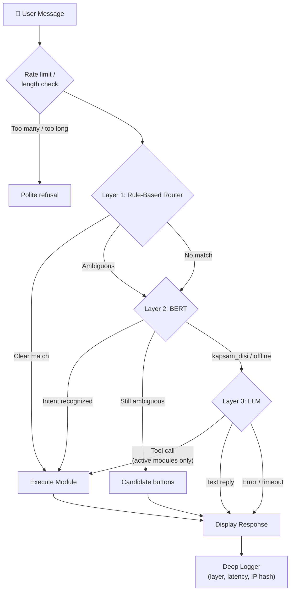

# MistikAI — Technical Architecture

## System Overview

MistikAI uses a 3-layer cascading architecture for intent resolution. Layers 2 and 3 are optional; when one is not configured or not reachable, the request moves on to the next step.

## Database Schema

```mermaid
erDiagram
    bot_moduller ||--o{ bot_anahtar_kelimeler : "has keywords"
    bot_moduller ||--o{ bot_sohbet_loglari : "logs interactions"
    bot_fakulteler ||--o{ bot_bolumler : "has departments"
    bot_bolumler ||--o{ bot_ders_programi : "has courses"
    bot_fakulteler ||--o{ bot_ders_programi : "belongs to"
    bot_varliklar ||--o{ bot_varlik_esanlamlilar : "has synonyms"
    bot_akis_menuleri ||--o{ bot_akis_butonlari : "has buttons"
    
    bot_moduller {
        int id PK
        string modul_kodu UK
        string modul_adi
        text cevap_metni
        boolean aktif_mi
    }
    
    bot_anahtar_kelimeler {
        int id PK
        int modul_id FK
        string kelime
        int oncelik "1-100 priority score"
        text cevap_override
        string zaman_kontrol
    }
    
    bot_sohbet_loglari {
        bigint id PK
        string session_id "salted IP hash"
        text kullanici_mesaji
        text bot_cevabi
        int guven_skoru "0-100"
        boolean anlasildi_mi
        string algilanan_niyet
        string katman "kural, bert, llm, akis, komut, sinir"
        int gecikme_ms "latency"
    }

    bot_admin_users {
        int id PK
        string kullanici_adi UK
        string sifre "bcrypt"
        string yetki "tam or kisitli"
    }

    bot_giris_denemeleri {
        bigint id PK
        string ip_ozeti "salted IP hash"
        string kullanici_adi
        timestamp deneme_tarihi
    }
```

`bot_api_rate_limit` (per-minute chat limit) and `bot_sistem_ayarlari` (key/value settings) are standalone tables. Existing installations get the new columns and tables from `database/migrations/2026-10-guvenlik.sql`.

## Rule-Based Router Algorithm

1. Normalize the input: Turkish-aware lower-casing (`İ` → `i`, `I` → `ı`) and punctuation cleanup. A second pass uses an ASCII-folded copy (`ç ğ ı ö ş ü` → `c g i o s u`), so `YARIN` and `yarin` both match `yarın`.
2. Compare against all active keywords from `bot_anahtar_kelimeler`, normalized the same way. Keywords are cached for about a minute, so admin edits can take that long to show.
3. Matching is word-based:
   - exact word or phrase;
   - **suffix tolerance:** a keyword of 4+ letters also matches a word that starts with it (`yemekhanede` → `yemekhane`, `dersler` → `ders`);
   - **typo tolerance:** words of 6+ letters match with one wrong, missing or extra letter.
4. Each module gets `priority + length_bonus` from its best keyword. Suffix, typo and ASCII-folded matches score a little lower than exact ones. Keywords with a time context (`sabah`, `aksam` …) lose points outside that time.
5. Sort modules by score. A clear winner runs its module (or its `cevap_override` text).
6. If the top two scores are too close, the result is **ambiguous** with up to three candidates. BERT is asked; the candidates can be offered to the user as buttons instead of guessing.
7. If nothing matches, the message goes to BERT, then the LLM.

The entity and synonym tables (`bot_varliklar`, `bot_varlik_esanlamlilar`) map variants such as `yazılım` to a canonical value (`bilgisayar` department) for modules that need it.

## Layer 2: BERT Service

`src/BertClient.php` posts `{"metin": "..."}` to the Python service (`bert-model/serve.py`, default `http://127.0.0.1:8005/niyet-algila`) with a short timeout and, when `$BERT_API_KEY` is set, an `X-Api-Key` header. The answer is `{"niyet": "...", "eminlik": 0.0-1.0}`. The service returns `kapsam_disi` for the out-of-scope class and for any prediction below its threshold (`BERT_ESIK`, default 0.6). PHP also ignores `kapsam_disi`, `bilinmiyor` and low-confidence answers and falls through to the LLM. See [bert-model/README.md](bert-model/README.md).

## Layer 3: LLM

- Groq's OpenAI-compatible chat completions API (`$GROQ_API_KEY`).
- **Tool calling:** the active modules (plus "show main menu") are offered as tools. A returned tool name is checked against that allow-list before anything runs.
- **System prompt:** assistant persona, `$OKUL_BILGISI`, the current date, weekday and time (Türkiye), and rules such as never inventing dates, phone numbers or names.
- **Limits:** `$LLM_MAX_TOKENS` per reply, a short recent chat history, per-request and total timeouts.
- **Fallback:** on HTTP 429/5xx the request is retried once after a short pause, then `$LLM_YEDEK_MODEL` is tried.
- **Graceful failure:** without an API key, or when both models fail, the user gets a short "cannot answer right now" message instead of an error.
- **Output:** treated as plain text. It is escaped, and only bold text, line breaks, lists and `https` links are rendered.

## Module Plugin System

Modules are PHP files in `modules/` that receive:
- `$clean_input` — Normalized user input
- `$raw_input` — Original user input  
- `$this` — MistikEngine instance (`$this->db`, `$this->response()`)

Return the value of `$this->response($html, $buttons)`. Module and flow HTML is passed through the allow-list sanitizer (`Guvenlik::temizHtml`) before it reaches the browser.

## Logging

Every answered message is logged with the module/intent, a 0-100 confidence score, whether it was understood, the answering layer (`katman`: `kural`, `bert`, `llm`, `akis`, `komut` or `sinir` for rate-limit/length refusals) and the latency in milliseconds. The visitor is identified by a salted SHA-256 hash of the IP (`$IP_TUZU`). Logs older than `$LOG_SAKLAMA_GUN` days are deleted.

## Security Layers

| Layer | Implementation |
|-------|---------------|
| Authentication | bcrypt hashed passwords, session-based admin auth, no default account, first-run setup page (`admin/kurulum.php`) |
| Authorization | Admin roles: `tam` (full) and `kisitli` (restricted); only full admins add admins or use the code editor / SQL terminal |
| Brute force | Failed logins counted per IP hash and username in `bot_giris_denemeleri`; further attempts are blocked for a while |
| CSRF | Per-session random token, checked on the chat API and every admin form (`Guvenlik::csrfDogrula`) |
| SQL Injection | PDO prepared statements, native (non-emulated) prepares |
| XSS | `htmlspecialchars()` on output, allow-list HTML sanitizer for bot replies, LLM output as text, Content Security Policy |
| Session | `HttpOnly`, `SameSite=Lax`, `Secure` on HTTPS, `use_strict_mode`, ID regenerated at login |
| Rate Limiting | Fixed one-minute window per client IP hash (`$DAKIKA_ISTEK_SINIRI`), message length limit (`$MESAJ_MAX_UZUNLUK`) |
| Client IP | `X-Forwarded-For` read only when the request comes from `$GUVENILIR_VEKILLER` |
| Code execution | In-browser PHP editor and SQL terminal off unless `$ADMIN_KOD_EDITORU = true` |
| SSRF | Scraper fetches only `http(s)` URLs on `$SCRAPER_IZINLI_HOSTLAR`, and only if every resolved IP is public |
| BERT service | Binds to `127.0.0.1`, optional `X-Api-Key` (constant-time compare), input length limit |
| CI | `php -l` (PHP 8.0 and 8.3), tests, Python compile and a gitleaks secret scan on every push and pull request |
