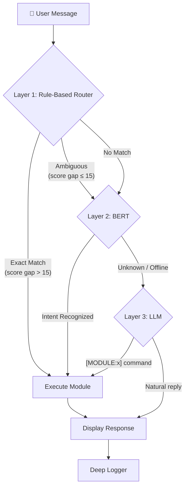
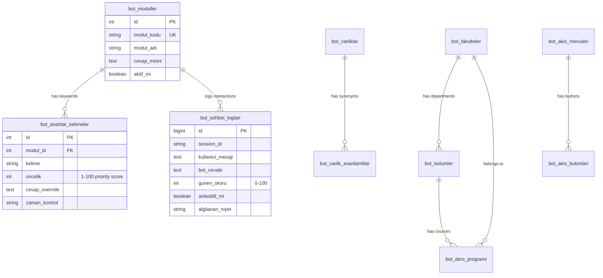

# MistikAI — Technical Architecture

## System Overview

MistikAI uses a 3-layer cascading architecture for intent resolution:

## Database Schema

## Rule-Based Router Algorithm

1. Normalize user input (lowercase, Turkish char handling)
2. Scan all active keywords from `bot_anahtar_kelimeler`
3. For each match: `score = max(priority, current_score) + length_bonus`
4. Sort modules by total score
5. If top 2 scores differ by < 15 → **ambiguous** → send to BERT
6. If clear winner → execute that module
7. If no matches → send to BERT

## Module Plugin System

Modules are PHP files in `modules/` that receive:
- `$clean_input` — Normalized user input
- `$raw_input` — Original user input  
- `$this` — MistikEngine instance (`$this->db`, `$this->response()`)

Return value must be a JSON string from `$this->response()`.

## Security Layers

| Layer | Implementation |
|-------|---------------|
| Authentication | bcrypt hashed passwords, session-based admin auth |
| CSRF | Per-session random token, verified on every API call |
| SQL Injection | PDO prepared statements exclusively |
| XSS | `htmlspecialchars()` on all user-facing output |
| Session | `httponly`, `samesite=Strict`, `use_strict_mode` |
| Rate Limiting | IP-based request counting per time window |
