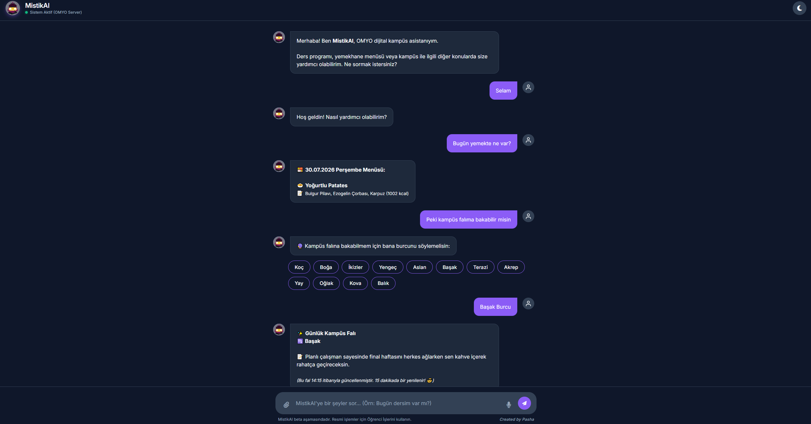
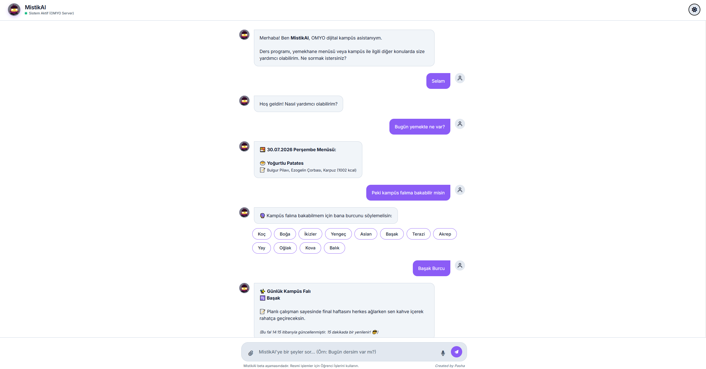
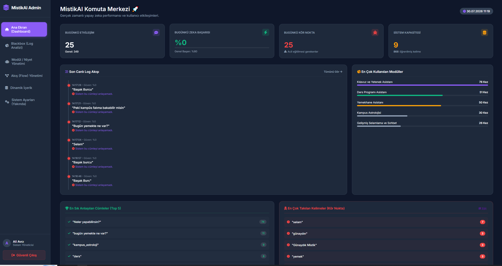
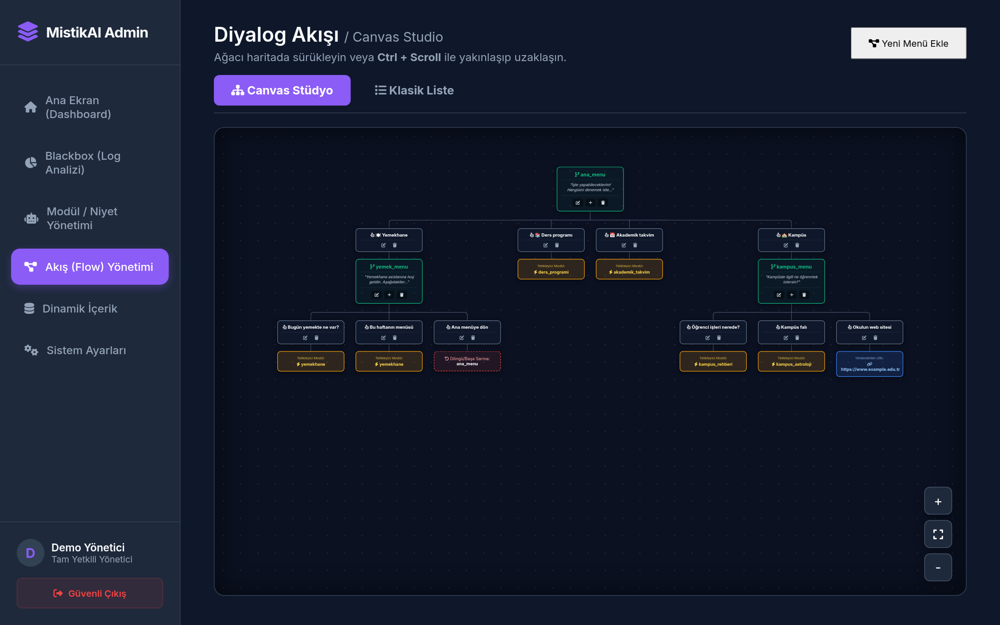
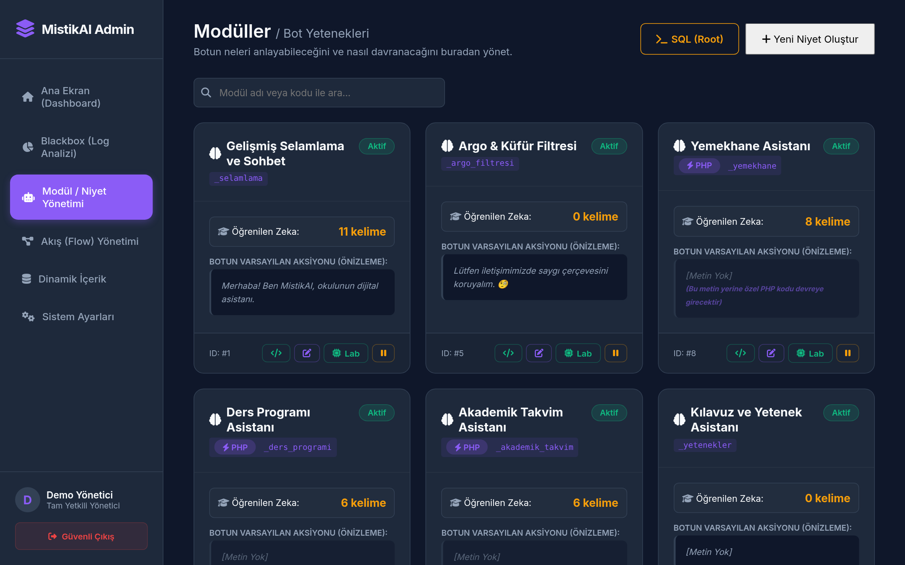
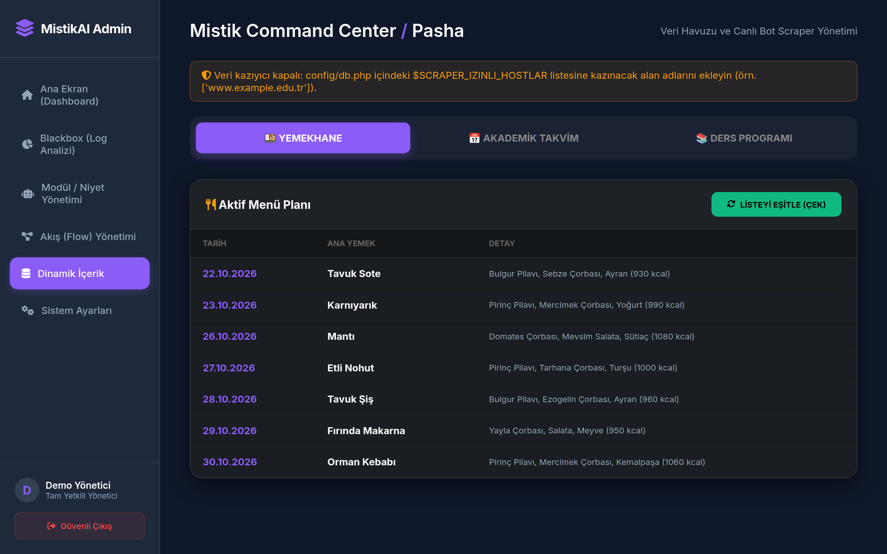

# MistikAI — Hybrid AI Campus Assistant

<div align="center">


**A 3-layer hybrid engine that combines rule-based keyword matching, custom-trained BERT intent recognition, and LLM-powered conversation for campus services.**

[Architecture](#architecture) · [Installation](#installation) · [Configuration](#configuration) · [Modules](#modules) · [Admin Panel](#admin-panel) · [BERT Training](#bert-model-training) · [Security](#security) · [Privacy](#privacy-kvkk--gdpr)

</div>

---

## Overview

MistikAI is a full-stack assistant built for **Osmaniye Meslek Yüksekokulu (OMYO)**. It gives students quick access to course schedules, cafeteria menus, the academic calendar, campus navigation and more through a modern chat interface.

It uses a **3-layer hybrid architecture**: fast keyword matching first, a custom-trained BERT model when the keywords are ambiguous, and an LLM for natural conversation. Each layer is optional except the first, so it also runs on plain shared hosting without Python or an API key.

## Screenshots

<details open>
<summary><b>View Interface & Admin Dashboard</b></summary>
<br>

| Chat Interface (Dark) | Chat Interface (Light) |
|:---:|:---:|
|  |  |

| Admin Dashboard | Flow Builder |
|:---:|:---:|
|  |  |

| Intelligence Lab (Intent) | Dynamic Content (Scraping) |
|:---:|:---:|
|  |  |

</details>

## Architecture

```
┌─────────────────────────────────────────────────────┐
│     User Message  (rate limit + length check)        │
└──────────────────────┬──────────────────────────────┘
                       ▼
         ┌──────────────────────────┐
         │  Layer 1: Rule-Based     │   Keywords editable in the
         │  Router (Keyword Match)  │   admin, priority scores 1-100
         └──────────┬───────────────┘
                    │
          ┌─────────┴─────────┐
          ▼                   ▼
    [Clear Match]      [Ambiguous / No Match]
          │                   │
          ▼                   ▼
    Execute Module    ┌──────────────────────┐
                      │  Layer 2: BERT       │   Optional, custom-trained
                      │  Intent Recognition  │   Turkish classifier
                      └──────────┬───────────┘
                                 │
                       ┌─────────┴─────────┐
                       ▼                   ▼
                 [Intent Found]    [kapsam_disi / offline]
                       │                   │
                       ▼                   ▼
                 Execute Module    ┌──────────────────────┐
                                   │  Layer 3: LLM Chat   │   Optional, Groq
                                   │  (tool calling)      │   (OpenAI-compatible)
                                   └──────────┬───────────┘
                                              │
                                              ▼
                                  Module call or text reply
                                              │
                                              ▼
                                   ┌──────────────────┐
                                   │  Deep Logger      │  layer, latency,
                                   │  (every message)  │  salted IP hash
                                   └──────────────────┘
```

### Why 3 Layers?

1. **Rule-Based Router** — Answers routine questions instantly from keywords with priority scores; no external calls. Matching is Turkish-aware (İ/I, ASCII folding such as `yarin` → `yarın`), tolerates suffixes (`dersim`, `dersler`) and small typos. When two modules score too close, the user can get candidate buttons instead of a guess.
2. **BERT Intent Recognition** — When keywords collide between modules (e.g. "yarın ne var" could be food or classes), the classifier picks the intent. Messages it considers out of scope (`kapsam_disi`) or below its confidence threshold go on to the LLM.
3. **LLM Conversation** — For free-form chat and questions that match no module. The model can call only the active modules through OpenAI-compatible tool calling, gets the current date in its system prompt, falls back to a second model when the first is unavailable, and fails gracefully with a short message.

See [ARCHITECTURE.md](ARCHITECTURE.md) for details.

## Features

| Feature | Description |
|---------|------------|
| 🎓 **Course Schedule** | Query daily/weekly class schedules by department and year |
| 🍽️ **Cafeteria Menu** | Today's, tomorrow's, or weekly meal menus with calories |
| 📅 **Academic Calendar** | Exam dates, registration periods, holidays |
| 🏫 **Campus Guide** | Building locations, classroom/lab floor mapping |
| 📞 **Phone Directory** | Live search of university staff directory |
| 🔮 **Campus Horoscope** | Fun daily horoscope with campus-themed predictions |
| 🛡️ **Profanity Filter** | Rule-based Turkish profanity detection |
| 🌙 **Dark/Light Theme** | Modern UI with theme toggle |
| 📊 **Admin Dashboard** | Log analysis (answering layer, latency), module management, keyword training |
| 🔄 **Dialog Flows** | Visual flow builder for multi-step conversations |

## Tech Stack

- **Backend:** PHP 8.0+ (OOP, PDO)
- **Database:** MySQL / MariaDB (utf8mb4)
- **AI Layer 1:** Rule-based engine with priority scoring and Turkish-aware fuzzy matching
- **AI Layer 2:** BERT (fine-tuned for Turkish intent classification), Python service
- **AI Layer 3:** Groq API (OpenAI-compatible; default `llama-3.3-70b-versatile`, fallback `llama-3.1-8b-instant`)
- **Frontend:** Vanilla JS, CSS3 (Glassmorphism, CSS Variables)
- **Security:** CSRF tokens, prepared statements, HTML allow-list sanitizer, CSP, session hardening

## Installation

### Prerequisites

- PHP 8.0+ with `curl`, `pdo_mysql`, `mbstring`, `dom` extensions
- MySQL 5.7+ or MariaDB 10.5+
- Apache with `mod_rewrite` (or Nginx equivalent)
- (Optional) Groq API key for the LLM layer
- (Optional) Python 3.9+ for the BERT service

### Step 1: Clone & Configure

```bash
git clone https://github.com/TheP4SHA/MistikAI.git
cd MistikAI

# Create your configuration file
cp config/db.php.example config/db.php
# Edit config/db.php: database credentials, API keys and at least $IP_TUZU
```

### Step 2: Database Setup

```bash
# Create the database
mysql -u root -p -e "CREATE DATABASE mistikai_db CHARACTER SET utf8mb4 COLLATE utf8mb4_unicode_ci;"

# Import schema
mysql -u root -p mistikai_db < database/schema.sql

# Import sample data (optional, for demo)
mysql -u root -p mistikai_db < database/seed.sql
```

### Step 3: Web Server

Point your web server's document root to the `public/` directory:

**Apache (Virtual Host):**
```apache
<VirtualHost *:80>
    DocumentRoot "/path/to/MistikAI/public"
    ServerName mistikai.local
    <Directory "/path/to/MistikAI/public">
        AllowOverride All
        Require all granted
    </Directory>
</VirtualHost>
```

### Step 4: First Admin

There is **no default admin account**. Open the first-run setup page `admin/kurulum.php` (for example `http://mistikai.local/admin/kurulum.php`) and create the first full admin. The page only works while no admin exists.

- **Chatbot:** `http://mistikai.local/`
- **Admin Panel:** `http://mistikai.local/admin`

Further admins are added from **Settings** by a full admin.

### Upgrading an Existing Installation

Back up the database, then run the migration once:

```bash
mysql -u USER -p mistikai_db < database/migrations/2026-10-guvenlik.sql
```

It adds the new columns and tables (admin roles, login attempts, log layer and latency), closes open panel registration, and **deletes any admin that still uses the password hash shipped in the old seed**. If that was your only admin, create a new one on `admin/kurulum.php`. Then compare your `config/db.php` with `config/db.php.example` and add the new keys.

Step-by-step instructions (XAMPP, Laragon, Nginx): [docs/SETUP_GUIDE.md](docs/SETUP_GUIDE.md).

## Configuration

All settings live in `config/db.php` as PHP variables (copy from `config/db.php.example`).

| Variable | Default | Description |
|----------|---------|-------------|
| `$DB_HOST` | `'127.0.0.1'` | Database host |
| `$DB_NAME` | `'mistikai_db'` | Database name |
| `$DB_USER` / `$DB_PASS` | — | Database credentials |
| `$GROQ_API_KEY` | placeholder | Groq API key; set it to `''` to run without the LLM layer |
| `$BERT_API_URL` | `'http://localhost:8005/niyet-algila'` | BERT service endpoint; empty disables layer 2 |
| `$BERT_API_KEY` | `''` | Shared secret sent as `X-Api-Key`; must match `BERT_API_KEY` of the service |
| `$BASE_PATH` | `''` | URL prefix when installed in a sub-folder, e.g. `'/MistikAI'` |
| `$ADMIN_TEMIZ_URL` | `false` | `true`: admin links use the `.htaccess` clean URLs (`/admin/dashboard`); `false`: direct files |
| `$ADMIN_KOD_EDITORU` | `false` | Enables the in-browser PHP module editor and SQL terminal (full admins only). Keep `false` in production |
| `$GUVENILIR_VEKILLER` | `[]` | Reverse-proxy IPs whose `X-Forwarded-For` header is trusted |
| `$IP_TUZU` | placeholder | Salt for the IP hash in logs and rate limiting. **Set a long random value** |
| `$LLM_MODEL` | `'llama-3.3-70b-versatile'` | Primary Groq model |
| `$LLM_YEDEK_MODEL` | `'llama-3.1-8b-instant'` | Fallback model when the primary is rate-limited or down |
| `$LLM_MAX_TOKENS` | `400` | Max tokens per LLM reply |
| `$LLM_API_URL` | Groq chat completions | Any OpenAI-compatible chat completions endpoint |
| `$DAKIKA_ISTEK_SINIRI` | `20` | Chat requests per minute per client |
| `$MESAJ_MAX_UZUNLUK` | `500` | Max characters per chat message |
| `$LOG_SAKLAMA_GUN` | `180` | Chat logs older than this many days are deleted |
| `$OKUL_BILGISI` | `'Osmaniye Meslek Yüksekokulu (OMYO)'` | Short school description for the LLM system prompt |
| `$SCRAPER_IZINLI_HOSTLAR` | `[]` | Hosts the content scraper may fetch, e.g. `['www.example.edu.tr']`; empty disables the scraper |

## Project Structure

```
MistikAI/
├── public/              # Web-accessible files
│   ├── index.php        # Chat interface
│   ├── api.php          # API entry point
│   └── assets/          # Static assets
│
├── src/                 # Core engine (OOP)
│   ├── MistikEngine.php # Main orchestrator
│   ├── RuleBasedRouter.php  # Layer 1: Keyword matching
│   ├── BertClient.php   # Layer 2: BERT API client
│   ├── LLMClient.php    # Layer 3: Groq/LLM client
│   ├── Logger.php       # Deep interaction logger
│   └── Guvenlik.php     # Security helpers (session, CSRF, sanitizer, IP hash, SSRF guard)
│
├── modules/             # Plugin modules
│   ├── ders_programi.php
│   ├── yemekhane.php
│   ├── akademik_takvim.php
│   ├── kampus_rehberi.php
│   ├── telefon_rehberi.php
│   └── kampus_astroloji.php
│
├── admin/               # Admin panel (kurulum.php = first-run setup)
├── database/            # SQL schema, seed data and migrations/
├── config/              # Configuration (db.php is gitignored)
├── bert-model/          # BERT dataset, training and inference service
├── tests/               # PHP test runner (php tests/run.php)
├── .github/workflows/   # CI: PHP lint + tests, Python compile, gitleaks
└── docs/                # Additional documentation
```

## Modules

Each module is a standalone PHP file in `modules/`. They receive `$clean_input`, `$raw_input`, and have access to `$this` (MistikEngine instance with `$this->db` and `$this->response()`).

### Creating a Custom Module

1. Create a new file in `modules/` (e.g., `kutuphane.php`)
2. Add the module to the `bot_moduller` table (or in the admin's Module Manager)
3. Add keywords to `bot_anahtar_kelimeler` (or in the Intelligence Lab)
4. The module is available to the router, and to the LLM while it is active

```php
<?php
// modules/kutuphane.php
// Available: $this->db, $this->response(), $clean_input, $raw_input

$html = "📚 <b>Kütüphane Bilgileri:</b><br>";
$html .= "Çalışma saatleri: 08:00 - 22:00<br>";
$html .= "Hafta sonu: 10:00 - 18:00";

return $this->response($html);
```

Module and flow replies pass through an allow-list HTML sanitizer: simple formatting tags (`b`, `i`, `br`, `p`, lists, tables, `span`/`div`, safe links and images) are kept, scripts and event handlers are removed. Escape any user input you echo back.

## Admin Panel

The admin panel provides:

- **Dashboard** — KPI cards, live log feed, module success rates
- **Blackbox Logger** — Every interaction with confidence score, answering layer (`katman`) and latency
- **Module Manager** — Create/edit modules; the in-browser PHP editor is off unless `$ADMIN_KOD_EDITORU = true`
- **Intelligence Lab** — Manage keywords, priority rules and the entity/synonym tables
- **Course Import** — Bulk import course schedules from structured text
- **Content Scraper** — Import cafeteria menus and the academic calendar from hosts listed in `$SCRAPER_IZINLI_HOSTLAR`
- **Flow Builder** — Visual dialog flow designer with canvas studio
- **Settings** — Scraper URLs; full admins can add other admins

Admins are either **full** (`tam`) or **restricted** (`kisitli`). Only full admins can add admins and, when enabled, use the code editor and SQL terminal.

## BERT Model Training

See [bert-model/README.md](bert-model/README.md) for:
- Building the dataset from the keyword database with Turkish templates and an out-of-scope class
- Training (fixed seed, stratified split, per-class report)
- Running the inference API on port 8005 with an API key, confidence threshold and `/saglik` health check

## Security

- ✅ CSRF tokens on the chat API and on every admin form
- ✅ Prepared statements (PDO) for all SQL queries
- ✅ Allow-list HTML sanitizer for module/flow replies; LLM output is rendered as text (bold, lists and `https` links only)
- ✅ Content Security Policy headers
- ✅ Session hardening (`HttpOnly`, `SameSite`, `Secure` on HTTPS, strict mode, new session ID at login)
- ✅ Login brute-force throttle (failed attempts per IP and username)
- ✅ Per-minute rate limit and message length limit on the chat API (configurable)
- ✅ In-browser PHP editor and SQL terminal disabled by default (`$ADMIN_KOD_EDITORU`)
- ✅ Scraper limited to `$SCRAPER_IZINLI_HOSTLAR`, with an SSRF guard against private/internal addresses
- ✅ `X-Forwarded-For` trusted only from `$GUVENILIR_VEKILLER`
- ✅ No default admin; first-run setup page, bcrypt password hashing
- ✅ BERT service bound to `127.0.0.1` with optional API key
- ✅ CI with PHP lint, tests and a gitleaks secret scan

Found a vulnerability? Please report it privately, see [SECURITY.md](SECURITY.md).

## Privacy (KVKK / GDPR)

- Chat logs and the rate limiter store a **salted hash of the IP address** (`$IP_TUZU`), not the IP itself.
- Logs are deleted after `$LOG_SAKLAMA_GUN` days (default 180).
- Message texts are stored in the logs so that admins can improve the keywords. Tell your users this.
- **When layer 3 is used, the user's message (and the short recent chat history) is sent to Groq**, a third-party service outside Türkiye. If you enable the LLM, you are responsible for disclosing this in your privacy notice (KVKK aydınlatma metni) and for having a legal basis. Set `$GROQ_API_KEY = ''` to keep all processing on your own server.

## Contributing

Contributions are welcome! Please open an issue or a Pull Request. CI must pass (`php -l`, `php tests/run.php`, gitleaks). See [CHANGELOG.md](CHANGELOG.md) for recent changes.

## Disclaimer / Legal Notice

> [!WARNING]
> This project includes web scraping scripts (within the admin panel's `icerik.php`) designed specifically as a **proof of concept** for Osmaniye Korkut Ata University (osmaniye.edu.tr). 
> 
> Scraping data from websites without explicit permission may violate their Terms of Service and could be considered unethical or illegal depending on your jurisdiction. The author assumes no responsibility for how these scripts are used. Always ensure you have the right to scrape, access, and store third-party data before deploying this in a production environment.

## License

This project is licensed under the MIT License - see the [LICENSE](LICENSE) file for details.

---

<div align="center">
<sub>Built with ❤️ by <strong>Pasha</strong> at Osmaniye Korkut Ata University</sub>
</div>
