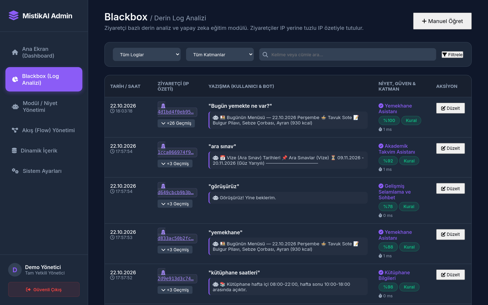
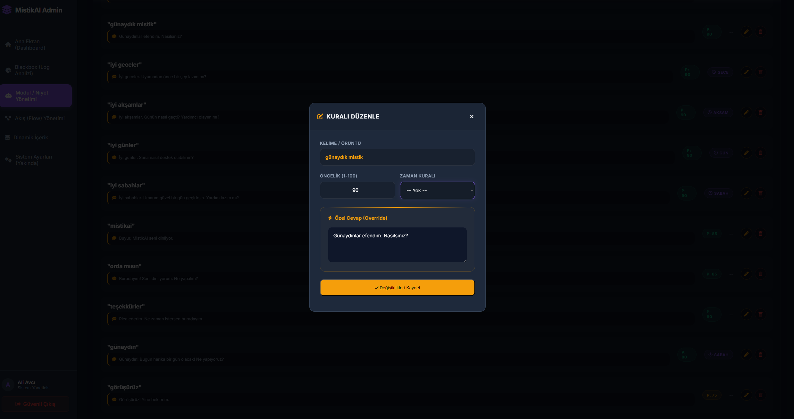

# MistikAI — Kendi Sunucunuzda Çalışan Kampüs Asistanı Motoru

<div align="center">


**Her okulun kendi sunucusuna kurup kendi verisiyle doldurabileceği, açık kaynak bir sohbet botu motoru: önce anahtar kelime kuralları, isteğe bağlı olarak BERT niyet modeli, en son isteğe bağlı bir LLM.**

[Özellikler](#özellikler) · [Mimari](#mimari) · [Hızlı başlangıç](#hızlı-başlangıç) · [Yapılandırma](#yapılandırma) · [Uyarlama](#mistikaiyi-okulunuza-uyarlama) · [Güvenlik ve gizlilik](#güvenlik-ve-gizlilik) · [BERT](#bert-servisi-isteğe-bağlı) · [Geliştirme](#geliştirme-ve-testler) · [English](README.md)

</div>

---

## Nedir?

MistikAI, öğrencilerin günlük sorularını bir sohbet penceresinde cevaplar: bugün yemekhanede ne var, yarın dersi var mı, vizeler ne zaman başlıyor, bir birim hangi katta. Düz PHP ve MySQL/MariaDB ile yazılmıştır ve bir yönetim paneliyle gelir; personel anahtar kelimeleri, cevapları, buton menülerini ve içeriği kod yazmadan yönetebilir.

Her mesaj en fazla üç katmandan geçer: hızlı anahtar kelime kuralları, isteğe bağlı bir BERT niyet sınıflandırıcısı ve isteğe bağlı bir LLM. Yalnız ilk katman zorunludur; MistikAI Python ya da API anahtarı olmadan sıradan bir paylaşımlı hostingde de çalışır.

MistikAI herhangi bir kuruma bağlı değildir. Depo, kurgusal bir okul (**"Örnek Meslek Yüksekokulu"**) için örnek veriyle gelir: bölümler, dersler, öğretim elemanları, yemekler ve tarihler uydurmadır. Bunları kendi verinizle değiştirin ([MistikAI'yi okulunuza uyarlama](#mistikaiyi-okulunuza-uyarlama)).

Sohbet arayüzü, yönetim paneli, birlikte gelen modüller ve anahtar kelime yönlendiricisi **Türkçedir**. Yönlendirici Türkçe büyük/küçük harfi (`İ`/`I`), ekleri ve Türkçe karakter kullanılmadan yazılmış metni anlar.

## Ekran Görüntüleri

<details open>
<summary><b>Sohbet ve yönetim paneli (örnek veri)</b></summary>
<br>

| Sohbet (karanlık) | Sohbet (aydınlık) |
|:---:|:---:|
|  |  |

| Ana ekran | Sohbet kayıtları |
|:---:|:---:|
|  |  |

| Akış tasarımcısı | Modüller |
|:---:|:---:|
|  |  |

| Dinamik içerik (yemek menüsü) | Zeka laboratuvarı |
|:---:|:---:|
|  |  |

</details>

## Özellikler

| | Özellik | Ne yapar |
|---|---------|----------|
| 🎓 | **Ders programı** | Bölüm ve sınıfı bir kez (butonlarla) sorar, oturum boyunca hatırlar; bugün, yarın, bir gün ya da tüm hafta için cevap verir |
| 🍽️ | **Yemek menüsü** | Yemek tablosundan bugünün, yarının, bir günün ya da haftanın menüsü |
| 📅 | **Akademik takvim** | Yaklaşan etkinlikler ya da kayıt, ekle-bırak, vize, final ve bütünleme tarihleri |
| 🏫 | **Kampüs rehberi** *(örnek)* | Kurgusal, tek binalı bir okul için birim, laboratuvar ve derslik kat bilgisi |
| 📞 | **Personel rehberi** *(örnek entegrasyon)* | JSON bir rehber API'sinde (`$REHBER_API_URL`) iki adımlı isim araması |
| 🔮 | **Kampüs falı** | Eğlencelik günlük burç yorumu |
| 💬 | **Metin cevapları** | Selamlaşma, hakarete nazik cevap ya da herhangi bir sabit cevap; PHP gerekmez |
| 🔄 | **Diyalog akışları** | Görsel akış tasarımcısında kurulan buton menüleri ve alt menüler |
| 🧠 | **Türkçeye duyarlı yönlendirici** | Harf katlama, ek ve yazım hatası toleransı, öncelikler, günün saatine göre kurallar, emin olunamadığında aday butonları |
| 🤖 | **Araç çağıran LLM** | İsteğe bağlı; yalnız aktif modülleri çağırabilir, bugünün tarihini bilir, ikinci bir modele düşer |
| 📊 | **Yönetim paneli** | Ana ekran, cevaplayan katman ve gecikmeyle sohbet kayıtları, modül yönetimi, zeka laboratuvarı, ders aktarımı, içerik kazıyıcı, akış tasarımcısı, ayarlar, yönetici rolleri |
| 🌙 | **Karanlık/aydınlık tema** | Tarayıcı başına hatırlanan tema düğmesi |

## Mimari

```
┌─────────────────────────────────────────────────────┐
│  Kullanıcı mesajı  (hız sınırı + uzunluk denetimi)   │
└──────────────────────┬──────────────────────────────┘
                       ▼
         ┌──────────────────────────┐
         │  1. katman: Kural tabanlı│   Anahtar kelimeler panelden
         │  yönlendirici            │   düzenlenir, öncelik 1-100
         └──────────┬───────────────┘
                    │
          ┌─────────┴─────────┐
          ▼                   ▼
    [Net eşleşme]     [Belirsiz / eşleşme yok]
          │                   │
          ▼                   ▼
   Modülü çalıştır    ┌──────────────────────┐
                      │  2. katman: BERT     │   İsteğe bağlı, kendi
                      │  niyet algılama      │   kelimelerinizle eğitilir
                      └──────────┬───────────┘
                                 │
                       ┌─────────┴─────────┐
                       ▼                   ▼
                 [Niyet bulundu]   [kapsam_disi / kapalı]
                       │                   │
                       ▼                   ▼
                Modülü çalıştır    ┌──────────────────────┐
                                   │  3. katman: LLM      │   İsteğe bağlı, OpenAI
                                   │  (araç çağırma)      │   uyumlu API (Groq)
                                   └──────────┬───────────┘
                                              │
                                              ▼
                                Modül çağrısı ya da metin cevap
                                              │
                                              ▼
                                   ┌──────────────────┐
                                   │  Kayıt (logger)   │  katman, gecikme,
                                   │  (her mesaj)      │  tuzlu IP özeti
                                   └──────────────────┘
```

1. **Kural tabanlı yönlendirici** rutin soruları dış çağrı yapmadan, öncelik puanlı anahtar kelimelerle anında cevaplar. Eşleştirme Türkçeye duyarlıdır (`İ`/`I`, `yarin` yazınca `yarın` eşleşir), ekleri (`yemekhanede` → `yemekhane`) ve uzun kelimelerde tek harflik yazım hatasını tolere eder. İki modülün puanı çok yakınsa tahmin etmek yerine aday butonları sunar.
2. **BERT niyet algılama**, modüller arasında çakışan kelimeleri ("yarın ne var" yemek de olabilir ders de) çözer. Kapsam dışı mesajlar (`kapsam_disi`) ve düşük güvenli tahminler LLM'e geçer.
3. **LLM sohbeti** serbest soruları karşılar. Model yalnız aktif modülleri çağırabilir (OpenAI uyumlu araç çağırma), sistem isteminde bugünün tarihini alır, ikinci bir modele düşer ve hata durumunda kısa, nazik bir mesaj verir.

Buton tıklamaları (`flow_…`, `modul_…`, `set_program_…`) katmanlara uğramadan doğrudan çalışır. Ayrıntı: [ARCHITECTURE.md](ARCHITECTURE.md).

## Hızlı başlangıç

### Gereksinimler

- PHP 8.0 ya da üstü; `pdo_mysql`, `curl`, `mbstring`, `dom` ve `json` eklentileri
- MySQL 5.7+ ya da MariaDB 10.5+ (utf8mb4)
- PHP çalıştıran bir web sunucusu (Apache, nginx + PHP-FPM ya da yerel deneme için PHP'nin yerleşik sunucusu)
- İsteğe bağlı: OpenAI uyumlu bir LLM için API anahtarı (varsayılan Groq)
- İsteğe bağlı: BERT servisi için Python 3.9–3.12

### 1. Kodu alın ve veritabanını oluşturun

```bash
git clone https://github.com/TheP4SHA/MistikAI.git
cd MistikAI

mysql -u root -p -e "CREATE DATABASE mistikai_db CHARACTER SET utf8mb4 COLLATE utf8mb4_unicode_ci;"
mysql -u root -p mistikai_db < database/schema.sql
mysql -u root -p mistikai_db < database/seed.sql     # isteğe bağlı: kurgusal okulun örnek verisi
```

Seed örnek modülleri, anahtar kelimeleri, bölümleri, dersleri, yemekleri, takvim kayıtlarını ve bir ana menüyü ekler. Yönetici hesabı oluşturmaz, kazıyıcı kaynak adresi de tanımlamaz.

### 2. Yapılandırın

```bash
cp config/db.php.example config/db.php
php -r "echo bin2hex(random_bytes(32)), PHP_EOL;"   # çıktıyı $IP_TUZU olarak kullanın
```

`config/db.php` dosyasında veritabanı bilgilerini, `$IP_TUZU` değerini ve `$OKUL_BILGISI` içine okulunuzun adını girin; `$GROQ_API_KEY` için ya bir LLM anahtarı verin ya da LLM'siz çalışmak için `''` yapın. BERT servisini çalıştırmıyorsanız `$BERT_API_URL = ''` yapın. Tüm anahtarlar [Yapılandırma](#yapılandırma) bölümünde. `config/db.php` git tarafından yok sayılır.

### 3. Yayına alın

MistikAI'nin derleme adımı yoktur. Sohbet sayfası `public/index.php` (istekleri `public/api.php`'ye gönderir), yönetim paneli `admin/` klasörüdür; ikisine de tarayıcıdan erişilebilmelidir.

PHP'nin yerleşik sunucusuyla yerel deneme, proje klasöründen:

```bash
php -S 127.0.0.1:8000 -t .
# sohbet: http://127.0.0.1:8000/public/
# panel:  http://127.0.0.1:8000/admin/
```

Gerçek bir web sunucusunda proje klasörünü web kökünün altına, örneğin `/MistikAI` olarak koyun: sohbet `https://sunucunuz/MistikAI/public/`, panel `https://sunucunuz/MistikAI/admin/` olur ve `$BASE_PATH` `'/MistikAI'` olmalıdır (proje web kökündeyse `''` bırakın). `config/`, `src/`, `modules/`, `database/`, `tests/` ve `bert-model/` web'den sunulmak için değildir; bunlara erişimi kapatın (örneğin Apache'de bu klasörlerin her birine `Require all denied` satırı olan bir `.htaccess`, nginx'te `location ~ ^/MistikAI/(config|src|modules|database|tests|bert-model)/ { deny all; }`). Belge kökünü `public/` yaparsanız `admin/` bunun dışında kalır ve ayrı bir alias gerekir. Sunucuya özel notlar: [docs/SETUP_GUIDE.md](docs/SETUP_GUIDE.md).

### 4. İlk yöneticiyi oluşturun

**Varsayılan yönetici hesabı yoktur.** İlk kurulum sayfası **`admin/kurulum.php`** adresini açın (örneğin `http://127.0.0.1:8000/admin/kurulum.php`) ve ilk tam yetkili yöneticiyi oluşturun (parola en az 10 karakter). Sayfa yalnız hiç yönetici yokken çalışır, sonrasında 404 döner. Girişi `admin/` adresinden yapın. Başka yöneticileri tam yetkili bir yönetici **Sistem Ayarları** bölümünden ekler.

Sonra sohbeti deneyin: `merhaba` yazınca selam gelmeli, **Neler yapabilirsin?** butonu ana menüyü açmalı. Örnek yemekler ve takvim kayıtları 2026'nın ilk yarısına aittir; bugüne ait cevaplar için kendi verinizi ekleyin.

### Mevcut bir kurulumu güncelleme

**1.0**'dan: veritabanını yedekleyin, sonra migration'ı bir kez çalıştırın (tekrar çalıştırmak güvenlidir):

```bash
mysql -u KULLANICI -p mistikai_db < database/migrations/2026-10-guvenlik.sql
```

Migration yönetici rollerini, giriş denemesi tablosunu ve log katman/gecikme sütunlarını ekler, panelden açık kaydı kapatır ve **1.0 seed'iyle gelen parola özetini hâlâ kullanan yöneticiyi siler**. Tek yöneticiniz bu idiyse `admin/kurulum.php` ile yenisini oluşturun.

Her güncellemede `config/db.php` dosyanızı `config/db.php.example` ile karşılaştırıp eksik anahtarları ekleyin. Kurumdan bağımsız sürümden itibaren:

- sohbet sayfası başlığı ve karşılama metni için `config/db.php` içindeki `$OKUL_BILGISI` değerini okur. Sohbet sayfası veritabanına bağlanmasın diye örnekteki PDO bağlantısını saran `if (!defined('MISTIK_YALNIZ_AYAR'))` korumasını kendi dosyanıza da kopyalayın;
- `$REHBER_API_URL` için yerleşik bir adres yoktur; telefon rehberi modülünü kullanıyorsanız tanımlayın;
- kazıyıcı kaynak adreslerinin yerleşik varsayılanı yoktur; veritabanınızda kayıtlı olanlar korunur.

Bkz. [CHANGELOG.md](CHANGELOG.md).

## Yapılandırma

Tüm ayarlar `config/db.php` içinde PHP değişkenleridir (`config/db.php.example` dosyasından kopyalanır).

| Değişken | Örnekteki varsayılan | Açıklama |
|----------|----------------------|----------|
| `$DB_HOST` | `'127.0.0.1'` | Veritabanı sunucusu |
| `$DB_NAME` | `'mistikai_db'` | Veritabanı adı |
| `$DB_USER` / `$DB_PASS` | örnek değerler | Veritabanı kullanıcı bilgileri |
| `$GROQ_API_KEY` | örnek değer | LLM ucu için API anahtarı; `''` ise 3. katman olmadan çalışır |
| `$BERT_API_URL` | `'http://localhost:8005/niyet-algila'` | BERT servis adresi; `''` ise 2. katman kapalı |
| `$BERT_API_KEY` | `''` | `X-Api-Key` başlığıyla gönderilen ortak sır; servisteki `BERT_API_KEY` ile aynı olmalı |
| `$BASE_PATH` | `''` | Alt klasöre kurulduysa URL öneki, ör. `'/MistikAI'` (sonda `/` yok) |
| `$ADMIN_TEMIZ_URL` | `false` | `true`: panel bağlantıları temiz URL kullanır (`/admin/dashboard`); bunları `admin/pages/*.php` dosyalarına yönlendiren kurallar gerekir. `false`: doğrudan dosyalar (`/admin/pages/dashboard.php`), her yerde çalışır |
| `$ADMIN_KOD_EDITORU` | `false` | Tarayıcı içi PHP modül editörü ve SQL terminali (yalnız tam yetkili). Canlı ortamda `false` bırakın |
| `$GUVENILIR_VEKILLER` | `[]` | `X-Forwarded-For` başlığına güvenilen ters vekil IP'leri, ör. `['127.0.0.1']` |
| `$IP_TUZU` | örnek değer | Log ve hız sınırındaki IP özeti için tuz. **Uzun, rastgele bir değer verin** |
| `$LLM_MODEL` | `'llama-3.3-70b-versatile'` | Birincil model |
| `$LLM_YEDEK_MODEL` | `'llama-3.1-8b-instant'` | Birincil model sınırlandığında ya da çöktüğünde yedek model |
| `$LLM_MAX_TOKENS` | `400` | LLM cevabı başına en fazla token |
| `$LLM_API_URL` | `'https://api.groq.com/openai/v1/chat/completions'` | OpenAI uyumlu herhangi bir chat completions ucu |
| `$DAKIKA_ISTEK_SINIRI` | `20` | İstemci başına dakikadaki sohbet isteği |
| `$MESAJ_MAX_UZUNLUK` | `500` | Mesaj başına en fazla karakter |
| `$LOG_SAKLAMA_GUN` | `180` | Bundan eski sohbet kayıtları silinir (gün) |
| `$OKUL_BILGISI` | `'Örnek Meslek Yüksekokulu'` | Okulunuzun adı: sohbet sayfası başlığı ve karşılama metni ile LLM sistem istemi. Boşsa örnek ad kullanılır |
| `$SCRAPER_IZINLI_HOSTLAR` | `[]` | İçerik kazıyıcının erişebileceği hostlar, ör. `['www.example.edu.tr']`; boşsa kazıyıcı kapalı |
| `$REHBER_API_URL` | `''` | Telefon rehberi modülünün personel rehberi API'si, ör. `'https://rehber.example.edu.tr/api/ara'`; boşsa modül "Rehber servisi ayarlanmamış." der |

Kazıyıcının kaynak sayfaları (yemek menüsü ve akademik takvim) bu dosyada değildir. Veritabanında tutulur ve panelde **Sistem Ayarları** bölümünden girilir; ikisi de varsayılan olarak boştur.

## MistikAI'yi okulunuza uyarlama

### 1. Ad ve örnek veri

- Okulunuzun adını `$OKUL_BILGISI` değişkenine yazın.
- Örnek veriyi değiştirin. Bölümler: `bot_fakulteler`, `bot_bolumler`. Dersler: **Dinamik İçerik → Ders Programı** (yapılandırılmış metinden toplu aktarım) ya da `bot_ders_programi`. Yemekler: `tip = 'yemek'` ile `bot_zaman_cizelgesi` ya da kazıyıcı. Takvim: `bot_akademik_takvim` ya da kazıyıcı. Buton menüleri: **Akış (Flow) Yönetimi**.
- Bölüm eş anlamlıları (`yazılım` → `bilgisayar` bölümü) `bot_varliklar` ve `bot_varlik_esanlamlilar` tablolarındadır.

### 2. Anahtar kelimeler

**Modül / Niyet Yönetimi** ekranındaki her modül kartında, o modülün zeka laboratuvarını açan bir **Lab** butonu vardır. Bir anahtar kelimenin:

- 1-100 arası önceliği (yüksek olan kazanır),
- modülü çalıştırmak yerine gönderilecek isteğe bağlı sabit cevabı (`cevap_override`),
- isteğe bağlı zaman kuralı (`sabah`, `gun`, `aksam`, `gece`; örneğin "günaydın" akşam daha düşük puan alır) vardır.

Eşleştirme kelime bazlıdır: tam kelime ve ifadeler, 4+ harfli kelimeler onlarla başlayan kelimelerle de eşleşir, 6+ harfli kelimelerde tek yazım hatasına izin verilir. Panelden kaydedilen değişiklikler hemen geçerli olur; veritabanında doğrudan yapılan değişiklikler en geç bir dakika içinde görünür (anahtar kelime önbelleği). **Blackbox** kaydı hiçbir şeyin anlamadığı mesajları listeler; onları oradan anahtar kelimeye çevirin.

### 3. Modüller

Modül, `bot_moduller` tablosunda bir satır ve isteğe bağlı olarak bir `modules/<modul_kodu>.php` dosyasıdır. Dosya yoksa modül sabit metniyle (`cevap_metni`) cevap verir. Yalnız aktif modüller ve yalnız `modules/` klasöründeki dosyalar çalışır.

1. Modülü **Modül / Niyet Yönetimi → Yeni Niyet Oluştur** ile ekleyin (ad, `a-z0-9_` kod, isteğe bağlı metin).
2. Dinamik cevap için `modules/<kod>.php` dosyasını ekleyin.
3. Modülün **Lab** ekranından anahtar kelimeleri girin.

```php
<?php
// modules/kutuphane.php
// Kullanılabilenler: $this->db (PDO), $this->response($html, $butonlar), $this->bekle($veri),
//                    $clean_input (küçük harf, noktalamasız, ASCII katlanmış), $raw_input, $bekleyen

$html  = "📚 <b>Kütüphane</b><br>";
$html .= "Hafta içi 08:00-22:00, hafta sonu 10:00-18:00";

return $this->response($html, [
    ['text' => '📅 Akademik takvim', 'payload' => 'modul_akademik_takvim'],
    ['text' => '🌐 Web sitesi', 'url' => 'https://www.example.edu.tr/kutuphane'],
]);
```

- Butonlar `['text' => …, 'payload' => …]` (`flow_<menü>`, `modul_<kod>` ya da düz metin) veya `['text' => …, 'url' => 'https://…']` biçimindedir.
- `$this->bekle([...])` kullanıcının sonraki mesajını, veriyi `$bekleyen` içinde vererek aynı modüle gönderir (telefon rehberindeki gibi iki adımlı sorular). Kullanıcı `iptal` yazarak vazgeçebilir.
- Modül ve akış HTML'i izin listeli bir süzgeçten geçer (biçim etiketleri, listeler, tablolar, `span`/`div`, güvenli bağlantılar, `https` görseller); betikler, olay öznitelikleri ve `javascript:` bağlantıları atılır. Kullanıcıdan ya da dış bir API'den gelip geri yazdığınız her şeyi kaçışlayın.
- LLM açıkken dosyası ya da sabit metni olan her aktif modül ona araç olarak sunulur; açıklama olarak modül adı (ve buton metni) kullanılır. Modüllere açık adlar verin.

`modules/kampus_rehberi.php`, `modules/telefon_rehberi.php` ve `modules/kampus_astroloji.php` dosya olarak gelir ama seed'de yoktur. Birini açmak için aynı kodla bir modül oluşturun.

### 4. Veri kaynakları

Aşağıdaki entegrasyonlar örnek bir site yapısı ve örnek bir API için yazılmış **örneklerdir**. Kendi kurumunuzun sayfalarına ve servislerine göre uyarlayın.

- **İçerik kazıyıcı** (`admin/pages/icerik.php`): yemek menüsünü ve akademik takvimi **Sistem Ayarları** bölümüne kaydedilen adreslerden çeker. Adres boşken kazıyıcı kaynak adresinin tanımlı olmadığını söyler ("kaynak adresi tanımlı değil") ve yalnız `$SCRAPER_IZINLI_HOSTLAR` listesindeki hostlara gider. `yemekAyristir()` tarih (`GG.AA.YYYY`), ana yemek, üç yan yemek ve kaloriden oluşan tablo satırları bekler; `takvimAyristir()` başlangıç tarihi, bitiş tarihi ve faaliyetten oluşan satırlar, `28 Temmuz 2025 Pazartesi` gibi tarihler ve dönemi değiştiren `GÜZ YARIYILI` / `BAHAR YARIYILI` satırları bekler. Bu iki işlevi kendi sayfalarınıza göre yeniden yazın ya da kazıyıcıyı hiç kullanmadan tabloları kendiniz doldurun. Yalnız izniniz olan sayfaları kazıyın; sitenin kullanım şartlarına ve robots kurallarına uyun.
- **Telefon rehberi** (`modules/telefon_rehberi.php`): `GET <$REHBER_API_URL>?aranan=<isim>` isteği atar ve öğeleri `adsoyad`, `unvankisa`, `birim`, `telefon`, `email` ve `resim` alanlarını içeren bir JSON dizi bekler. `$REHBER_API_URL` boşsa ağa çıkmadan "Rehber servisi ayarlanmamış." der. İsteği ve alan adlarını kendi rehber servisinize göre değiştirin.
- **Kampüs rehberi** (`modules/kampus_rehberi.php`): birimler ve kat planı (1-8 nolu derslikler 1. katta vb.) kurgusal bir binayı anlatır. Kendi kampüsünüze göre düzenleyin.

### 5. Dil ve saat dilimi

Cevaplar, LLM sistem istemi ve yönlendiricinin normalleştirmesi Türkçedir; tarihler `Europe/Istanbul` saat dilimini kullanır (`public/api.php` ve LLM istemi). Okulunuz başka bir yerdeyse bunları değiştirin.

## Yönetim paneli

- **Ana Ekran (Dashboard)**: bugünkü etkileşimler, başarı oranı, kör noktalar, en çok kullanılan modüller, canlı kayıt akışı
- **Blackbox (Log Analizi)**: her mesaj; modül, 0-100 güven, cevaplayan katman (`kural`, `bert`, `llm`, `akis`, `komut`, `sinir`) ve gecikmeyle; buradan süzün ve öğretin
- **Modül / Niyet Yönetimi**: modül oluşturma, düzenleme, durdurma; her modül için anahtar kelimeleri yöneten **Lab**; PHP editörü ve SQL terminali yalnız `$ADMIN_KOD_EDITORU = true` iken
- **Akış (Flow) Yönetimi**: tuval ya da liste görünümünde buton menüleri; butonlar alt menü açar, modül çalıştırır ya da bağlantı açar
- **Dinamik İçerik**: yemek menüsü ve akademik takvim (kazıyıcı) ile ders programı aktarımı
- **Sistem Ayarları**: kazıyıcı kaynak adresleri; tam yetkililer yönetici hesaplarını yönetir

Yöneticiler **tam** (`tam`) ya da **kısıtlı** (`kisitli`) yetkilidir. Yönetici eklemeyi ve (açıksa) kod editörü ile SQL terminalini yalnız tam yetkililer kullanır.

## Güvenlik ve gizlilik

- Sohbet API'sinde ve tüm panel formlarında CSRF jetonu
- Tüm SQL sorgularında yerel (emüle edilmeyen) PDO prepared statement
- Modül ve akış cevapları için izin listeli HTML süzgeci; LLM çıktısı metin olarak gösterilir (yalnız kalın yazı, liste ve `https` bağlantısı)
- Content Security Policy ve diğer güvenlik başlıkları
- Oturum sertleştirme: `HttpOnly`, `SameSite=Lax`, HTTPS'te `Secure`, strict mode, girişte yeni oturum kimliği
- Panel girişinde IP ve kullanıcı adı başına deneme freni
- Sohbet API'sinde dakika başına hız sınırı ve mesaj uzunluğu sınırı
- Tarayıcı içi PHP editörü ve SQL terminali varsayılan olarak kapalı (`$ADMIN_KOD_EDITORU`)
- Kazıyıcı `$SCRAPER_IZINLI_HOSTLAR` ile sınırlı, otomatik yönlendirme yok, çözülen her IP genel olmalı (SSRF koruması)
- `X-Forwarded-For` yalnız `$GUVENILIR_VEKILLER` listesindeki vekillerden kabul edilir
- Varsayılan yönetici yok; ilk kurulum sayfası; bcrypt parola özetleri
- BERT servisi `127.0.0.1` üzerinde, isteğe bağlı API anahtarıyla
- CI: PHP lint, testler ve gitleaks gizli bilgi taraması

**Gizlilik (KVKK / GDPR)**

- Sohbet kayıtları ve hız sınırlayıcı IP adresinin kendisini değil, **tuzlu özetini** (`$IP_TUZU`) saklar.
- Kayıtlar `$LOG_SAKLAMA_GUN` gün sonra silinir (varsayılan 180).
- Yöneticiler anahtar kelimeleri geliştirebilsin diye mesaj metinleri kayıtlarda tutulur. Kullanıcılarınızı bilgilendirin.
- **3. katman kullanıldığında kullanıcının mesajı ve kısa sohbet geçmişi LLM sağlayıcısına gönderilir** (varsayılan Groq; Türkiye dışında üçüncü taraf bir hizmet). Açıyorsanız bunu aydınlatma metninizde belirtin ve hukuki dayanağınız olduğundan emin olun. `$GROQ_API_KEY = ''` tüm işlemenin kendi sunucunuzda kalmasını sağlar.

Bir güvenlik açığı bulursanız gizli olarak bildirin: [SECURITY.md](SECURITY.md).

## BERT servisi (isteğe bağlı)

`bert-model/` klasörü 2. katman için gerekenleri içerir:

- `extract_dataset.py` anahtar kelimelerinizden (Türkçe şablonlarla çoğaltarak) ve `kapsam_disi.txt` dosyasındaki kapsam dışı cümlelerden veri seti üretir,
- `train.py` Türkçe bir BERT modelini ince ayarlar (sabit seed, katmanlı bölme, sınıf bazında rapor),
- `serve.py` modeli `127.0.0.1:8005` üzerinde sunar (`POST /niyet-algila`, `GET /saglik`); isteğe bağlı `BERT_API_KEY` ve güven eşiği (`BERT_ESIK`, varsayılan 0.6) vardır.

`$BERT_API_URL` değişkenini servise yönlendirin ve aynı `$BERT_API_KEY` değerini verin. Modül ya da çok sayıda anahtar kelime ekledikten sonra yeniden eğitin. Ayrıntı: [bert-model/README.md](bert-model/README.md).

## Geliştirme ve testler

```
MistikAI/
├── public/          # sohbet sayfası (index.php), API (api.php), varlıklar
├── admin/           # yönetim paneli; kurulum.php = ilk kurulum
├── src/             # motor: MistikEngine, RuleBasedRouter, BertClient, LLMClient, Logger, Guvenlik …
├── modules/         # modül dosyaları (modules/<modul_kodu>.php)
├── config/          # db.php.example (db.php olarak kopyalanır, git yok sayar)
├── database/        # schema.sql, seed.sql (örnek veri), migrations/
├── bert-model/      # BERT veri seti, eğitim ve servis
├── tests/           # bağımlılıksız PHP test koşucusu
├── docs/            # kurulum kılavuzu
└── .github/         # CI iş akışı, gitleaks ayarı
```

```bash
php tests/run.php                                               # birim testleri
MISTIK_TEST_DB_NAME=mistik_test MISTIK_TEST_DB_USER=... MISTIK_TEST_DB_PASS=... php tests/run.php
                                                                # + veritabanı testleri (her biri geri alınan bir işlemde)
find . -name '*.php' -not -path './vendor/*' -print0 | xargs -0 -n1 php -l
python3 -m py_compile bert-model/*.py
```

CI (GitHub Actions) PHP 8.0 ve 8.3'te `php -l` ve testleri çalıştırır, Python betiklerini derler ve gitleaks taraması yapar. Katkılar memnuniyetle karşılanır: issue ya da pull request açın, CI'ı yeşil tutun. Değişiklikler [CHANGELOG.md](CHANGELOG.md) dosyasındadır.

## Lisans

MIT, bkz. [LICENSE](LICENSE).

---

<div align="center">
<sub>MIT License · © TheP4SHA</sub>
</div>
